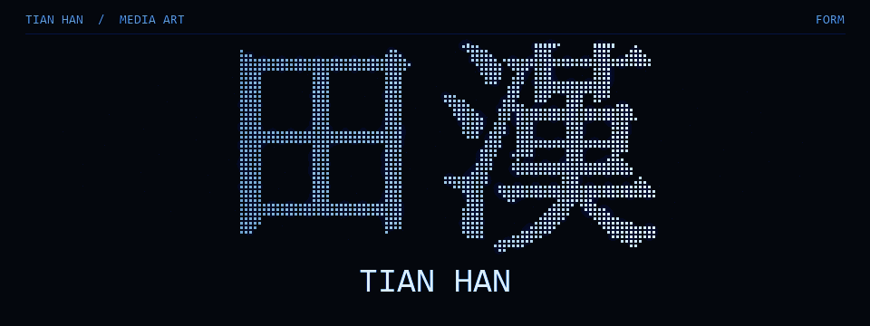

애니메이션 박사 · 미디어 아티스트 · 부산

<a href="https://openc2023.github.io/web-media/">포트폴리오 ↗</a> &nbsp; / &nbsp; <a href="https://openc2023.github.io/web-media/#elsewhere">인터랙티브 실험 ↗</a> &nbsp; / &nbsp; <a href="https://img.7studio.org/">브랜드 자료 ↗</a>

<a href="README.md">EN</a> · <a href="README.zh-CN.md">中文</a> · <a href="README.ko.md">한국어</a>

