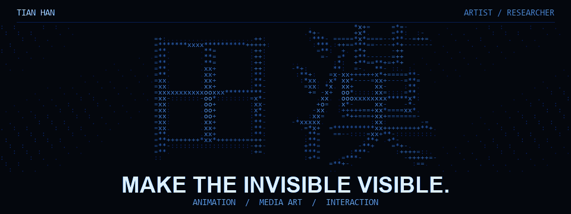

动画博士 · 媒体艺术家 · 釜山

<a href="https://openc2023.github.io/web-media/">作品集 ↗</a> &nbsp; / &nbsp; <a href="https://openc2023.github.io/web-media/#elsewhere">交互实验 ↗</a> &nbsp; / &nbsp; <a href="https://img.7studio.org/">品牌资源 ↗</a>

<a href="README.md">EN</a> · <a href="README.zh-CN.md">中文</a> · <a href="README.ko.md">한국어</a>

