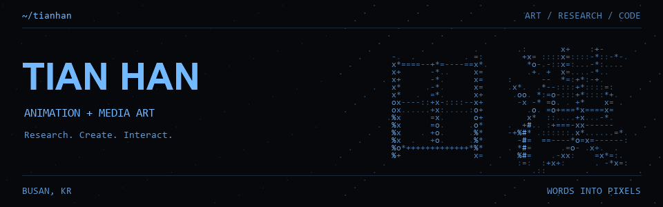

[English](README.md) · [中文](README.zh-CN.md) · [한국어](README.ko.md)

# 田漢 / Tian Han / 티앤한

**动画博士 · 媒体艺术家 · 韩国釜山**

研究漫画动画图像、沉浸式媒体艺术与城市再生，把研究方法带入影像和交互体验。

支持中韩双语研究、翻译与创作协作。

[Portfolio](https://openc2023.github.io/web-media/) · [Interactive works](https://openc2023.github.io/web-media/#elsewhere) · [STUDIO 7](https://github.com/openc2023/7S) · [ORCID](https://orcid.org/0009-0004-8437-134X)

## 精选项目

| Project | 简介 | 浏览 |
| :-- | :-- | :-- |
| **web-media** | 个人作品集、ASCII 字符实验与网页互动作品。 | [Live](https://openc2023.github.io/web-media/) · [Code](https://github.com/openc2023/web-media) |
| **STUDIO 7 / 07S** | STUDIO 7 / 07S 网站与作品展示项目。 | [Code](https://github.com/openc2023/7S) |
| **C / SPLIT Identity** | C / SPLIT 品牌资源：18 款 SVG、PNG 与可编辑 Illustrator 源文件。 | [Live](https://img.7studio.org/) · [Code](https://github.com/openc2023/content) |

## 研究与实践

沉浸式媒体 · 投影映射 · 生成艺术 · 动画研究 · 互动装置

[论文与出版](https://openc2023.github.io/web-media/#papers) · [完整作品集](https://art717.notion.site/box)

---

[静态横幅](assets/tianhan-static.png) · [仓库 / 源码](https://github.com/openc2023/openc2023)
